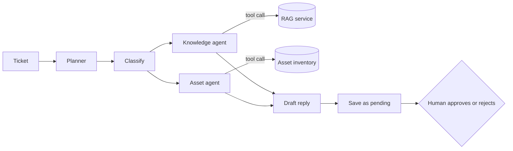

# IT Support Agent System

[](https://github.com/pujitha-vasanth/it-support-agent/actions/workflows/quality-gate.yml)

A retrieval-grounded agent system that answers internal IT questions from a
policy and runbook corpus (30 documents, about 400 pages), and drafts ticket
replies that wait for human approval.

Built to test one idea: most IT tickets are already answered somewhere in the
documentation. If retrieval is good enough and the system refuses to guess,
those tickets can be resolved without a person writing the reply.

## What it does

- Answers staff IT questions with citations back to the source document and section
- Says `NOT_COVERED` when no retrieved source supports an answer, instead of guessing
- Triages incoming tickets: category, priority, queue, and whether it can be auto-resolved
- Looks up the requester's devices in the asset inventory when the ticket needs it
- Drafts a reply and holds it as `pending`. Nothing is sent until a person approves it
- Blocks any code change that makes the answers or the routing worse (see Quality gate)
- Logs the latency, tokens and cost of every request, shown live on a dashboard

## How it works



Two layers, served from one FastAPI app:

**1. Knowledge service (RAG)**
- Documents are split on headings, then a sliding word window with overlap. Every chunk is prefixed with its document title and section
- Chunks are embedded with OpenAI and stored in Postgres with pgvector
- Each query runs vector search and Postgres full-text keyword search, merges the two lists with reciprocal rank fusion, then reorders the shortlist with a cross-encoder
- The answer is written only from the retrieved chunks and carries citations

**2. Triage agent (LangGraph)**
- A planner decides which sub-agents a ticket needs
- After classification, the knowledge and asset sub-agents run in parallel when both are needed
- The knowledge agent calls the RAG service as a tool. The queue is resolved from the owner of the retrieved document
- The final node writes the draft to the database as `pending`. Approving is a separate human action (CLI or API)

## Design decisions

| Decision | Why |
|---|---|
| Hybrid search, not pure vector | IT docs are full of exact strings (error codes, hostnames, policy numbers) that embeddings alone retrieve poorly |
| Rank fusion before reranking | Vector and keyword scores are not on the same scale. Fusing by rank avoids tuning weights |
| Cross-encoder reranking on a shortlist only | Hybrid search has good recall but weak ordering at the top. The cross-encoder is slow, so it never sees the whole corpus |
| Title and section prefix on every chunk | "Step 3: click Connect" is meaningless without "VPN runbook" |
| Abstain when no source matches | A wrong IT answer costs more than no answer |
| RAG exposed as a tool, not baked into the agent | Retrieval stays independently testable and reusable by any agent |
| Typed shared state | Sub-agents write named fields (category, priority, citations), not free text, so each step is inspectable in the trace |
| Human approval gate | Anything that reaches a real user is reviewed first |

## Evaluation

Two evaluation scripts, both writing results to `eval_results/` so runs can be compared.

**Knowledge service** (50-question golden set)
- Retrieval hit rate, and hit rate at rank 1 after reranking
- Faithfulness: every claim in the answer is supported by the retrieved context (model-judged)
- Correctness against a reference answer (model-judged)
- Abstention on questions that are answerable (each one is a miss)

**Triage agent** (50 labelled tickets)
- Category, priority and routing accuracy
- Auto-resolve rate, reported together with **false auto-resolve rate** (tickets auto-resolved that needed a human). The second number is the one that matters
- Asset tool recall: did the planner call the asset tool when the ticket needed it

Both evals also record the system's own latency and cost per question and per ticket, measured apart from the judge calls, so the figures describe what a real request costs.

`make eval-free` runs retrieval scoring only, with no model calls and no cost.

## Quality gate

The evals only matter if something acts on them. `eval/gate.py` compares the latest results with the scores saved in `eval/baseline.json` and fails if any has dropped.

- **Baseline rules:** a score may drift down by 2 points (to absorb judge noise), but no further
- **Hard limit:** false auto-resolve rate is capped at 5% and never moves with the baseline, because that is the failure that reaches a real user
- **Two profiles**, because offline and full runs measure different things:

| Profile | When it runs | Cost | What it gates |
|---|---|---|---|
| `fake` | every push and pull request | free | retrieval hit rate, hit rate @1, routing accuracy, priority within one level, false auto-resolves |
| `openai` | on demand from the Actions tab, and every Monday | a few US cents | all of the above, plus faithfulness, correctness, category accuracy, auto-resolve recall, asset tool recall |

The offline profile uses hashed word-count embeddings and a stub model, so its numbers are not the system's real quality. They are a fixed reference point: if a change to chunking, retrieval, reranking, the graph or the routing logic moves them, the change is caught before it merges. Routing is meaningful offline because the queue comes from the owner of the retrieved document, not from the model.

Checked by breaking it on purpose: switching off the reranker raised the plain hit rate (96%) but dropped hit rate @1 from 84% to 80%, and the gate failed the change.

```bash
make eval-offline   # both evals, no key, exactly as CI runs them
make gate           # pass or fail against the baseline
make baseline       # save the latest scores as the new bar (after a real improvement)
```

## Running it as a service

- **Request log:** every call to `/knowledge/ask`, `/knowledge/search` and `/agent/triage` writes one row to `request_log` with latency, tokens, estimated cost and outcome (answered, not covered, auto-resolvable, held, error)
- **Dashboard:** `/` shows a try-it box for questions and tickets, live volume, median and p95 latency, cost per answer and per ticket, the not-covered rate, today's spend, and the quality bar the gate enforces. `/metrics` returns the same numbers as JSON
- **Spend cap:** model calls stop for the day once logged spend passes `DAILY_BUDGET_USD` (default $1), so a public demo cannot run up a bill
- **Rate limit:** each visitor gets `RATE_LIMIT_PER_MINUTE` requests a minute (default 20)
- **Container:** the `Dockerfile` builds one image for the API and dashboard; the database is any Postgres with pgvector, set by `DATABASE_URL`. On first start it creates the tables and loads the corpus. CI builds the image on every push so it cannot silently break

Cost figures are estimates from the per-million-token prices in `.env` (`PRICE_*`). Check them against the provider's current price list before quoting a number.

## Data

All data is synthetic and generated by `data/generate.py` for a fictional company, Meridian Group: the document corpus, the golden questions, the 50 tickets and a 60-device asset inventory. Generation is deterministic, so an eval score only changes when the system changes, never because the data shifted.

## Run it locally

You need Python 3.11+, Docker (for Postgres with pgvector) and an OpenAI API key.

```bash
git clone https://github.com/pujitha-vasanth/it-support-agent.git
cd it-support-agent
python -m venv .venv
source .venv/bin/activate        # Windows: .venv\Scripts\activate
cp .env.example .env             # then add your OPENAI_API_KEY

make db-up                       # start Postgres + pgvector in Docker
make setup                       # install, check setup, generate data, ingest
make api                         # API at http://localhost:8000, docs at /docs
```

Try it:

```bash
python -m knowledge.search "how long does a VPN session last?"
make triage                      # triage all 50 sample tickets into the queue
make pending                     # list drafts waiting for a human
python -m agent.approve approve 3 --by "Your Name"
make eval                        # run both evaluations
make gate                        # pass or fail them against the baseline
```

Open http://localhost:8000 for the dashboard.

No key? Set `PROVIDER=fake` in `.env` to run the whole pipeline as a smoke test. Retrieval still works; answers will be placeholder text.

Run `make help` for every command. `docs/Setup guide.docx` walks through setup step by step, and `Diagrams.docx` has the architecture diagrams.

## API

| Endpoint | Purpose |
|---|---|
| `POST /knowledge/search` | Retrieval only, returns ranked chunks |
| `POST /knowledge/ask` | Grounded answer with citations |
| `POST /agent/triage` | Triage one ticket into the approval queue |
| `GET /agent/runs`, `GET /agent/runs/{id}` | Review drafts |
| `POST /agent/runs/{id}/approve`, `/reject` | Human decision |
| `GET /metrics` | Live latency, cost and outcome numbers from the request log |
| `GET /` | Dashboard |
| `GET /health` | Database and table check |

## Project structure

```
app.py          FastAPI app: knowledge and agent routes
knowledge/      ingestion, hybrid retrieval, reranking, grounded answers
agent/          LangGraph graph, nodes, tools, typed state, approval CLI
shared/         config, database, chunking, model provider (OpenAI or fake)
eval/           knowledge and agent evaluations, model judges, quality gate, baseline
web/            dashboard page
.github/        quality gate on every push, full eval on demand, container build
data/           synthetic corpus, golden set, tickets, asset inventory, generator
scripts/        setup check, batch ticket run, hosted start
```

## Limitations

- Single English-language corpus. No multi-tenant access control
- 50 golden questions and 50 tickets catch regressions but are not a broad benchmark
- The asset agent reads a CSV inventory, not a live CMDB
- The free CI gate runs offline, so it catches regressions in the pipeline, not changes in model behaviour. That is what the full eval is for
- The rate limit is held in memory, which suits one server. Several servers would need a shared store
- No sign-in on the dashboard or the approval endpoints. Fine for a synthetic demo, not for real tickets

## Stack

Python, FastAPI, LangGraph, OpenAI, Postgres + pgvector, sentence-transformers (cross-encoder), Docker, GitHub Actions
