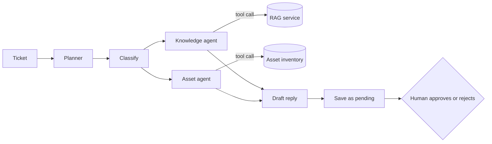

# IT Support Agent System

A retrieval-grounded agent system that answers internal IT questions from a
policy and runbook corpus (30 documents, about 400 pages), and drafts ticket
replies that wait for human approval.

Built to test one idea: most IT tickets are already answered somewhere in the
documentation. If retrieval is good enough and the system refuses to guess,
those tickets can be resolved without a person writing the reply.

## What it does

- Answers staff IT questions with citations back to the source document and section
- Says `NOT_COVERED` when no retrieved source supports an answer, instead of guessing
- Triages incoming tickets: category, priority, queue, and whether it can be auto-resolved
- Looks up the requester's devices in the asset inventory when the ticket needs it
- Drafts a reply and holds it as `pending`. Nothing is sent until a person approves it

## How it works



Two layers, served from one FastAPI app:

**1. Knowledge service (RAG)**
- Documents are split on headings, then a sliding word window with overlap. Every chunk is prefixed with its document title and section
- Chunks are embedded with OpenAI and stored in Postgres with pgvector
- Each query runs vector search and Postgres full-text keyword search, merges the two lists with reciprocal rank fusion, then reorders the shortlist with a cross-encoder
- The answer is written only from the retrieved chunks and carries citations

**2. Triage agent (LangGraph)**
- A planner decides which sub-agents a ticket needs
- After classification, the knowledge and asset sub-agents run in parallel when both are needed
- The knowledge agent calls the RAG service as a tool. The queue is resolved from the owner of the retrieved document
- The final node writes the draft to the database as `pending`. Approving is a separate human action (CLI or API)

## Design decisions

| Decision | Why |
|---|---|
| Hybrid search, not pure vector | IT docs are full of exact strings (error codes, hostnames, policy numbers) that embeddings alone retrieve poorly |
| Rank fusion before reranking | Vector and keyword scores are not on the same scale. Fusing by rank avoids tuning weights |
| Cross-encoder reranking on a shortlist only | Hybrid search has good recall but weak ordering at the top. The cross-encoder is slow, so it never sees the whole corpus |
| Title and section prefix on every chunk | "Step 3: click Connect" is meaningless without "VPN runbook" |
| Abstain when no source matches | A wrong IT answer costs more than no answer |
| RAG exposed as a tool, not baked into the agent | Retrieval stays independently testable and reusable by any agent |
| Typed shared state | Sub-agents write named fields (category, priority, citations), not free text, so each step is inspectable in the trace |
| Human approval gate | Anything that reaches a real user is reviewed first |

## Evaluation

Two evaluation scripts, both writing results to `eval_results/` so runs can be compared.

**Knowledge service** (50-question golden set)
- Retrieval hit rate, and hit rate at rank 1 after reranking
- Faithfulness: every claim in the answer is supported by the retrieved context (model-judged)
- Correctness against a reference answer (model-judged)
- Abstention on questions that are answerable (each one is a miss)

**Triage agent** (50 labelled tickets)
- Category, priority and routing accuracy
- Auto-resolve rate, reported together with **false auto-resolve rate** (tickets auto-resolved that needed a human). The second number is the one that matters
- Asset tool recall: did the planner call the asset tool when the ticket needed it

`make eval-free` runs retrieval scoring only, with no model calls and no cost.

## Data

All data is synthetic and generated by `data/generate.py` for a fictional company, Meridian Group: the document corpus, the golden questions, the 50 tickets and a 60-device asset inventory. Generation is deterministic, so an eval score only changes when the system changes, never because the data shifted.

## Run it locally

You need Python 3.11+, Docker (for Postgres with pgvector) and an OpenAI API key.

```bash
git clone https://github.com/pujitha-vasanth/it-support-agent.git
cd it-support-agent
python -m venv .venv
source .venv/bin/activate        # Windows: .venv\Scripts\activate
cp .env.example .env             # then add your OPENAI_API_KEY

make db-up                       # start Postgres + pgvector in Docker
make setup                       # install, check setup, generate data, ingest
make api                         # API at http://localhost:8000, docs at /docs
```

Try it:

```bash
python -m knowledge.search "how long does a VPN session last?"
make triage                      # triage all 50 sample tickets into the queue
make pending                     # list drafts waiting for a human
python -m agent.approve approve 3 --by "Your Name"
make eval                        # run both evaluations
```

No key? Set `PROVIDER=fake` in `.env` to run the whole pipeline as a smoke test. Retrieval still works; answers will be placeholder text.

Run `make help` for every command. `docs/Setup guide.docx` walks through setup step by step, and `Diagrams.docx` has the architecture diagrams.

## API

| Endpoint | Purpose |
|---|---|
| `POST /knowledge/search` | Retrieval only, returns ranked chunks |
| `POST /knowledge/ask` | Grounded answer with citations |
| `POST /agent/triage` | Triage one ticket into the approval queue |
| `GET /agent/runs`, `GET /agent/runs/{id}` | Review drafts |
| `POST /agent/runs/{id}/approve`, `/reject` | Human decision |
| `GET /health` | Database and table check |

## Project structure

```
app.py          FastAPI app: knowledge and agent routes
knowledge/      ingestion, hybrid retrieval, reranking, grounded answers
agent/          LangGraph graph, nodes, tools, typed state, approval CLI
shared/         config, database, chunking, model provider (OpenAI or fake)
eval/           knowledge and agent evaluations, model judges
data/           synthetic corpus, golden set, tickets, asset inventory, generator
scripts/        setup check, batch ticket run
```

## Limitations

- Single English-language corpus. No multi-tenant access control
- 50 golden questions and 50 tickets catch regressions but are not a broad benchmark
- The asset agent reads a CSV inventory, not a live CMDB
- Evaluations run on demand, not in CI

## Stack

Python, FastAPI, LangGraph, OpenAI, Postgres + pgvector, sentence-transformers (cross-encoder), Docker
