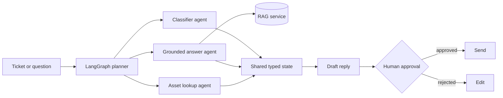

# IT Support Agent System

A retrieval-grounded agent system that answers internal IT questions from a
400-page policy and runbook corpus, and drafts ticket replies for human approval.

Built to test one idea: most IT tickets are already answered somewhere in the
documentation. If retrieval is good enough and the system refuses to guess,
those tickets never need to be opened.

## What it does

- Answers staff IT questions with citations pointing back to the source document
- Refuses to answer when no source supports the question, instead of guessing
- Classifies incoming tickets, looks up the user and their assets, and drafts a reply
- Holds every outbound action behind a human approval gate

## How it works



Two layers:

**1. Retrieval service (FastAPI)**
Documents are chunked recursively and embedded with Azure OpenAI into pgvector.
Queries run hybrid search, combining vector similarity with BM25 keyword matching,
and the candidate set is reordered by a cross-encoder before it reaches the model.
Answers are synthesised only from retrieved chunks and always carry citations.

**2. Agent layer (LangGraph)**
A planner routes each ticket to three sub-agents that share typed state:
classification, grounded answer (which calls the retrieval service as a tool),
and user and asset lookup. Their outputs are composed into a draft reply that a
human reviews before anything is sent.

## Design decisions

| Decision | Why |
|---|---|
| Hybrid search instead of pure vector | IT docs are full of exact strings such as error codes, hostnames and policy numbers that embeddings alone retrieve poorly |
| Cross-encoder reranking | Recall from hybrid search is good, precision at the top is not. Reranking fixes ordering before the model sees anything |
| Refusal when no source matches | A wrong IT answer costs more than no answer. The system is tuned to abstain rather than to always respond |
| RAG exposed as a tool, not embedded in the agent | Keeps retrieval independently testable and reusable by any agent that needs it |
| Typed shared state | Sub-agents pass structured objects, not free text, so failures surface as validation errors rather than silent corruption |
| Human approval gate | Anything that touches a real user is reviewed first. The system assists, it does not act alone |

## Evaluation

Scored against a 50-question golden set built from real ticket history, measuring:

- **Faithfulness**, whether the answer is supported by the retrieved chunks
- **Retrieval hit rate**, whether the correct source appears in the top-k results
- **Refusal accuracy**, whether unanswerable questions are correctly declined

Regression runs on every change to chunking, embedding model or prompt.

## Stack

Python, FastAPI, LangGraph, LangChain, Azure OpenAI, pgvector, Supabase

## Getting started

```bash
git clone https://github.com/pujitha-vasanth/<repo>.git
cd <repo>
pip install -r requirements.txt
cp .env.example .env     # add Azure OpenAI and Supabase credentials
python scripts/ingest.py --source ./docs
uvicorn app.main:app --reload
```

Evaluation:

```bash
python scripts/evaluate.py --golden-set ./eval/golden_set.json
```

## Project structure
app/ FastAPI service, retrieval and agent graph
scripts/ Ingestion and evaluation
eval/ Golden set and results
docs/ Source corpus (not committed)

## Limitations

- Tuned for a single English-language corpus. Multi-tenant access control is not implemented
- Evaluated on 50 questions, which catches regressions but is not a broad benchmark
- The asset lookup agent reads from a mock inventory, not a live CMDB
